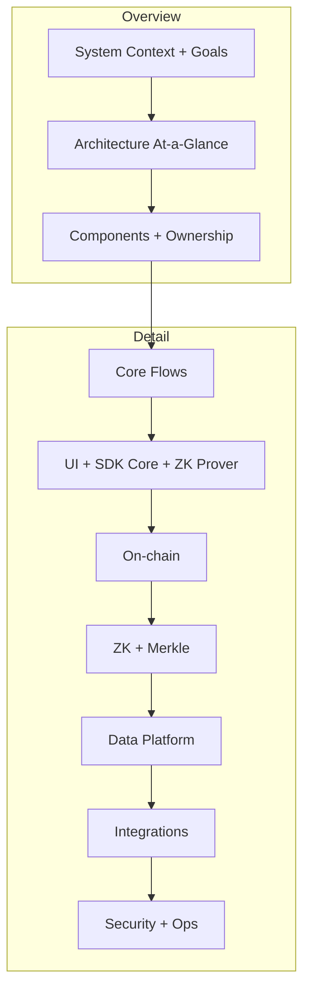

# VeilLend System Design

Purpose
- Provide a high-mid level architecture view of the VeilLend protocol.
- Use a System Design Primer-style structure: requirements → constraints → architecture → data flow → tradeoffs → reliability → security.
- Document current implementation + near-term hardening.

Primer-style doc template (applied across files)
- Requirements: functional + non-functional.
- Constraints: protocol + platform constraints.
- Architecture: context + components + data ownership.
- Data flow: core request/transaction path.
- Data model: what is stored where.
- Capacity + SLOs: CCU, p95/p99 latency targets (theoretical).
- Scaling: bottlenecks and mitigation levers.
- Reliability: failure modes + degraded behavior.
- Security: trust boundaries + abuse controls.
- Tradeoffs: why this design over alternatives.

Reading order (by audience)
- Product/Protocol: 01-overview.md → 02-current-state-lite.md → 03-components.md
- Frontend/SDK: 05-ui-sdk.md → 04-touchpoints.md → 07-zk.md
- On-chain: 06-onchain.md → 07-zk.md
- Infra/Ops: 08-data-platform.md → 10-security-ops.md

Glossary (canonical terms)
- Note string: user-facing bearer string that encodes note data.
- Commitment: Poseidon hash of note fields; stored as leaf in Merkle tree.
- Nullifier: Poseidon-derived value that marks a note spent (prevents double spend).
- Merkle root/path: inclusion proof for a note commitment.
- SECURE / FAST / NOTE_FAST: instruction families with increasing privacy guarantees.
- Proof cache: local storage of proof outputs keyed by input + artifact version.
- SIWS session: Sign-In With Solana session used for API access.

Design invariants
- On-chain state is the source of truth; indexer is a derived cache.
- Poseidon must be consistent across client, circuits, and on-chain.
- Nullifier can be spent only once per vault.
- LTV is enforced on-chain (70% default).
- Wallet-only auth (no email/password).

Source-of-truth references
- Product and risk: .agent-workflow/PRD.md, .agent-workflow/PRD.json, .agent-workflow/Risk_Register.md
- Architecture decisions: .agent-workflow/Architecture_Decisions.md, .agent-workflow/ADR/*
- Code: src/* (Frontend UI + SDK Core), programs/veillend/* (on-chain), circuits/veillend/* (circuits)
- Design reference: https://github.com/donnemartin/system-design-primer

Update triggers
- Any change to note format, Merkle depth, circuits, proof system, or on-chain accounts.
- Any change to auth, indexing, or partner integrations (Client Encryption (Arcium) / RPC + Webhooks (Helius) / Underlying Lending Market (Kamino)).
